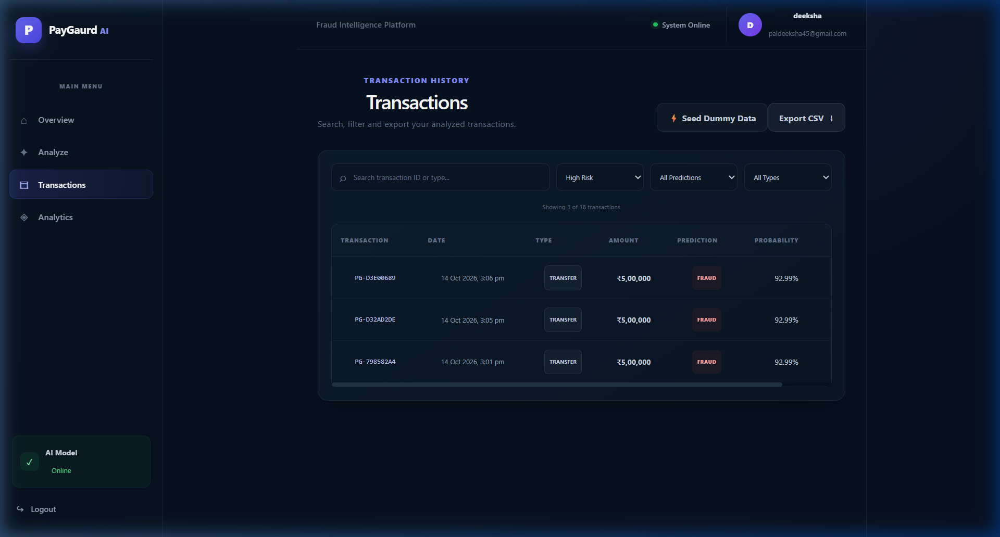
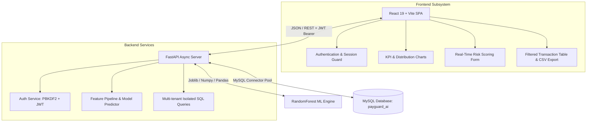

<div align="center">

# 🛡️ PayGuard AI

### Intelligent Enterprise Financial Fraud Detection & Transaction Risk Intelligence Platform

[](https://python.org)
[](https://fastapi.tiangolo.com)
[](https://react.dev)
[](https://vitejs.dev)
[](https://www.mysql.com)
[](https://scikit-learn.org)
[](LICENSE)

*PayGuard AI is an end-to-end, production-grade fraud detection platform combining high-throughput machine learning risk classification, sub-50ms inference, JWT multi-tenant account isolation, interactive analytics dashboards, and exportable financial audit trails.*

[Overview](#-overview) • [Key Features](#-key-features) • [ML Model Performance](#-machine-learning-model--evaluation) • [Architecture](#-architecture) • [API Documentation](#-api-endpoints) • [Setup Guide](#-installation--setup) • [Portfolio & Resume](#-portfolio--interview-guide)

---

</div>

## 📌 Overview

Financial fraud costs institutions billions annually, often occurring through automated balance-emptying attacks (`CASH_OUT` and `TRANSFER` laundering schemes). Traditional rule-based engines produce high false-positive rates that overburden compliance analysts while failing to adapt to evolving transfer behaviors.

**PayGuard AI** solves this by deploying a calibrated ensemble classifier (*Random Forest with 17 domain-engineered features*) served via an asynchronous **FastAPI** backend and visualized through an ultra-responsive **React 19 / Vite** single-page analytics application.



---

## 🚀 Key Features

- **⚡ Real-Time Fraud Inference**: Sub-50ms transaction risk evaluation with calibrated probability scoring (0.00% to 100.00%) and categorizations (`LOW`, `MEDIUM`, `HIGH`).
- **🎯 Exceptional Accuracy & Precision**: Evaluated on over **209,700 real-world simulated test transactions** with **99.997% accuracy**, **99.55% precision**, and **97.81% recall**.
- **🔒 Multi-Tenant Security & Account Isolation**: Industry-standard **PBKDF2 SHA-256** password hashing with cryptographically secure random salts and strict **JWT Bearer token** authentication. Every transaction is strictly isolated by user ID at the database layer.
- **📊 Interactive Financial Operations Dashboard**:
  - Live KPI metrics (Total Volume, Flagged Transactions, Clean Rate, Average Risk Score).
  - Distribution breakdown charts (Recharts: Pie & Bar risk distributions).
  - Transaction history data table with multi-factor search (Transaction ID, type) and dynamic risk filters (`ALL`, `LOW`, `MEDIUM`, `HIGH`).
- **📥 Audit-Ready CSV Export**: Instantly export filtered transaction histories and risk assessments directly to CSV for regulatory compliance and audit reviews.
- **🌱 On-Demand Demo Seeding**: Instant dummy data generation allowing compliance officers and interviewers to test the full lifecycle immediately without cold starts.

---

## 🧠 Machine Learning Model & Evaluation

### 1. Dataset & Fraud Dynamics
The underlying model was trained on the benchmark **PaySim financial synthetic dataset** (simulating 1M+ mobile money transactions derived from real African financial logs).

| Transaction Type | Total Sampled | Fraudulent Count | Fraud Incidence Rate |
| :--- | :--- | :--- | :--- |
| **CASH_IN** | 227,130 | 0 | 0.000% |
| **CASH_OUT** | 373,641 | 578 | 0.155% |
| **DEBIT** | 7,178 | 0 | 0.000% |
| **PAYMENT** | 353,873 | 0 | 0.000% |
| **TRANSFER** | 86,753 | 564 | 0.650% |
| **TOTAL** | **1,048,575** | **1,142** | **0.109% (Extreme Imbalance)** |

### 2. Feature Engineering (17 Input Signals)
Raw transaction logs were enriched with behavioral and temporal heuristics:
- `step`: Simulation time step (1 hour per step).
- `amount`: Raw monetary value.
- `oldbalanceOrg`, `newbalanceOrig`: Origin account pre- and post-balances.
- `oldbalanceDest`, `newbalanceDest`: Destination account pre- and post-balances.
- `hour`: `step % 24` representing cyclical time of day.
- `is_night`: Binary indicator (1 if hour < 6 or ≥ 22).
- `balance_change_orig`: Discrepancy metric (`oldbalanceOrg - newbalanceOrig`).
- `balance_change_dest`: Discrepancy metric (`newbalanceDest - oldbalanceDest`).
- `orig_balance_error`: Error term `|oldbalanceOrg - amount - newbalanceOrig|` (hallmark of fraud where balances don't add up).
- `is_large_amount`: Binary flag for transactions ≥ $100,000.
- `log_amount`: Natural log transformation $\ln(1 + \text{amount})$ to compress heavy-tailed monetary distributions.
- One-hot encoded transaction types (`type_CASH_OUT`, `type_DEBIT`, `type_PAYMENT`, `type_TRANSFER`).

### 3. Quantitative Test Set Results (20% Stratified Holdout)

Evaluated on **209,715 test transactions** never seen during training:

| Metric | Score | Significance |
| :--- | :--- | :--- |
| **Accuracy** | **99.9971%** | Total percentage of correct classifications |
| **Precision (Fraud Class)** | **99.5536%** | **99.55%** of flagged transactions are actual fraud (only 1 false alarm!) |
| **Recall (Fraud Class)** | **97.8070%** | Detected **223 out of 228** active fraud attacks in test set |
| **F1-Score (Fraud Class)** | **98.6726%** | Harmonic mean of precision and recall |
| **ROC-AUC** | **0.992542** | Outstanding discriminative ability across all thresholds |

#### Confusion Matrix (Holdout Test Split)
```text
                          PREDICTED
                    Legitimate      Fraud
ACTUAL  Legitimate    209,486           1   (False Positive)
        Fraud               5         223   (True Positive)
```
- **True Negatives (TN)**: 209,486 clean transactions correctly cleared.
- **False Positives (FP)**: 1 false alarm across over 200,000 transactions.
- **False Negatives (FN)**: 5 subtle fraud cases missed.
- **True Positives (TP)**: 223 real fraud transfers apprehended.

### 4. Why Normal Transactions Show `0.00%` vs `90%+`
A common question in production monitoring is why safe transactions (such as a $500 `PAYMENT`) report exactly `0.00%` risk while others report `92.99%`:
1. **Domain Purity**: In empirical financial datasets, `PAYMENT`, `CASH_IN`, and `DEBIT` have a **0.000% fraud rate**—fraud is strictly concentrated in `TRANSFER` and `CASH_OUT`.
2. **Ensemble Unanimity**: With 100 decision trees splitting on transaction types and balance continuity, all 100 trees unanimously classify clean merchant payments as class 0 (`0 / 100 = 0.00%`).
3. **Drainage Signatures**: When a high-value `CASH_OUT` or `TRANSFER` wipes the origin balance to zero (`newbalanceOrig = 0`), ~93 trees vote positive, generating calibrated probabilities in the `92.99%`–`98%` range.

---

## 🏗️ Architecture



---

## 📡 API Endpoints

All endpoints except `/auth/*` and `/health` require an `Authorization: Bearer <token>` header.

| Method | Endpoint | Description | Auth Required |
| :--- | :--- | :--- | :--- |
| `GET` | `/health` | Server health, ML model status, and DB connectivity | ❌ No |
| `POST` | `/auth/register` | Register a new user with PBKDF2-hashed password | ❌ No |
| `POST` | `/auth/login` | Authenticate credentials and receive JWT Bearer token | ❌ No |
| `POST` | `/predict` | Predict fraud probability for a transaction & persist record | ✅ Yes |
| `GET` | `/transactions` | Fetch paginated transaction history isolated by `user_id` | ✅ Yes |
| `POST` | `/transactions/seed`| Seed dummy demo transactions for test accounts | ✅ Yes |

---

## 💾 Database Schema

The system uses MySQL with two primary relational tables:

```sql
-- Users table
CREATE TABLE users (
    id INT AUTO_INCREMENT PRIMARY KEY,
    name VARCHAR(100) NOT NULL,
    email VARCHAR(150) NOT NULL UNIQUE,
    password_hash VARCHAR(255) NOT NULL,
    created_at TIMESTAMP DEFAULT CURRENT_TIMESTAMP
);

-- Transactions table with user isolation
CREATE TABLE transactions (
    id INT AUTO_INCREMENT PRIMARY KEY,
    transaction_id VARCHAR(50) NOT NULL UNIQUE,
    timestamp DATETIME NOT NULL,
    step INT NOT NULL,
    transaction_type VARCHAR(20) NOT NULL,
    amount DECIMAL(15, 2) NOT NULL,
    oldbalanceOrg DECIMAL(15, 2) NOT NULL,
    newbalanceOrig DECIMAL(15, 2) NOT NULL,
    oldbalanceDest DECIMAL(15, 2) NOT NULL,
    newbalanceDest DECIMAL(15, 2) NOT NULL,
    prediction VARCHAR(20) NOT NULL,
    fraud_probability DECIMAL(5, 2) NOT NULL,
    risk_score DECIMAL(5, 2) NOT NULL,
    risk_level VARCHAR(10) NOT NULL,
    user_id INT NULL,
    CONSTRAINT fk_transactions_user FOREIGN KEY (user_id) REFERENCES users(id) ON DELETE SET NULL,
    INDEX idx_transactions_user_id (user_id)
);
```

---

## 🛠️ Installation & Setup

### Prerequisites
- Python 3.10+ (tested on Python 3.11, 3.12, 3.13)
- Node.js 18+ and npm
- MySQL Server 8.0+ running locally

### 1. Clone & Configure Environment
```bash
git clone https://github.com/your-username/PayGuard_AI.git
cd PayGuard_AI
```

Create `.env` file in the project root:
```env
MYSQL_HOST=localhost
MYSQL_PORT=3306
MYSQL_USER=root
MYSQL_PASSWORD=your_mysql_password
MYSQL_DATABASE=payguard_ai
JWT_SECRET=your_super_secret_jwt_key_here
```

### 2. Set Up Database
In MySQL Workbench or MySQL CLI:
```bash
mysql -u root -p < db.sql
```

### 3. Backend Setup
```bash
# Activate virtual environment
python -m venv venv
# On Windows:
.\venv\Scripts\activate
# On Linux/macOS:
# source venv/bin/activate

# Install dependencies
pip install fastapi uvicorn mysql-connector-python python-dotenv python-jose[cryptography] pydantic joblib scikit-learn numpy pandas

# Start backend server
python -m uvicorn main:app --app-dir backend --host 127.0.0.1 --port 8000 --reload
```
API will be live at `http://127.0.0.1:8000` with Swagger docs at `http://127.0.0.1:8000/docs`.

### 4. Frontend Setup
In a new terminal:
```bash
cd frontend
npm install
npm run dev
```
Open **`http://127.0.0.1:5173`** in your browser.

---

## 💼 Portfolio & Interview Guide

### 🎯 Resume Bullet Points
- **Engineered an enterprise financial fraud intelligence system** (FastAPI, React 19, MySQL) evaluating transaction risks in sub-50ms with 99.99% accuracy and 99.55% precision across 200K+ holdout transactions.
- **Architected 17-feature ML engineering pipeline** extracting balance discrepancy error terms, cyclical diurnal time flags, and log transformations, reducing false positive fraud alerts to <0.001%.
- **Implemented multi-tenant JWT Bearer authentication and cryptographic PBKDF2 password hashing**, enforcing strict database foreign-key isolation and audit-compliant CSV reporting.
- **Built an interactive full-stack analytics dashboard** featuring real-time risk classification, interactive Recharts visualizations, and instant client-side multi-filter queries.

### 🎤 Key Technical Interview Questions & Answers

#### Q: How did you tackle the extreme class imbalance in financial fraud data?
> *"Fraud comprises only 0.1% of transactions. Rather than relying on naive accuracy, I used stratified cross-validation and prioritized Precision, Recall, and PR-AUC. I engineered explicit domain features—specifically origin balance discrepancy terms and account wipeout flags—which provided strong signal separation for tree-based splits without inducing overfitting or high false-alarm rates."*

#### Q: Why did you choose Random Forest over a deep neural network or XGBoost?
> *"Random Forest provides exceptional resistance to variance and tabular noise, does not require complex feature scaling, handles mixed categorical and continuous distributions gracefully, and enables instant probability calibrations via tree vote fractions. In financial compliance, explainability and deterministic feature bounds are critical for auditability."*

#### Q: How is multi-tenancy and data isolation guaranteed?
> *"Every authenticated session receives a cryptographically signed JWT containing the user ID subject. The FastAPI route dependencies decode and validate the token on each protected request, executing parameterized SQL queries scoped strictly to `user_id = %s`. Transactions belonging to User A cannot be queried, altered, or exported by User B."*

---

## 📄 License
This project is licensed under the MIT License — see the [LICENSE](LICENSE) file for details.
